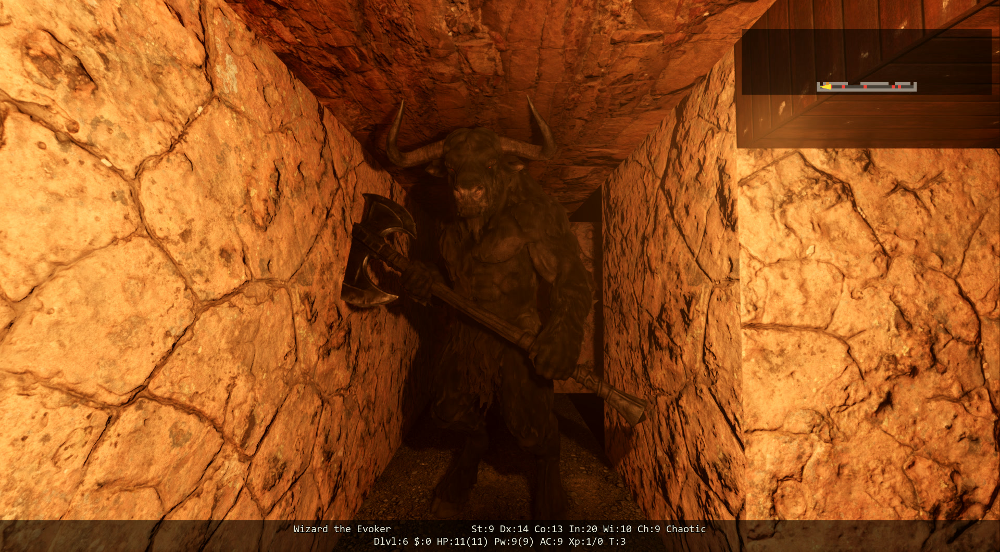
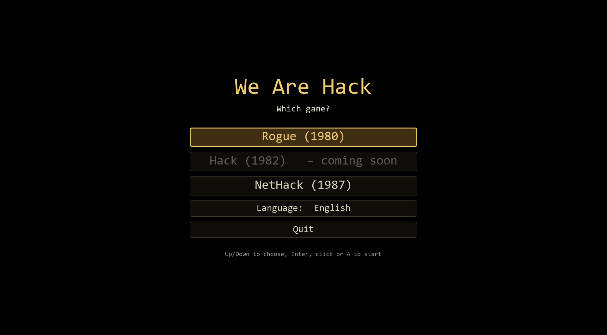
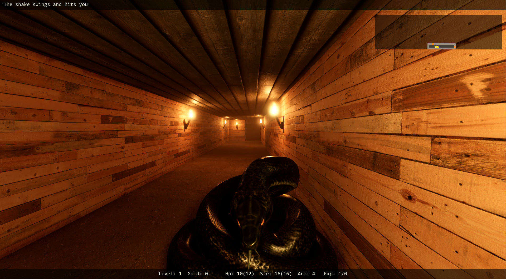
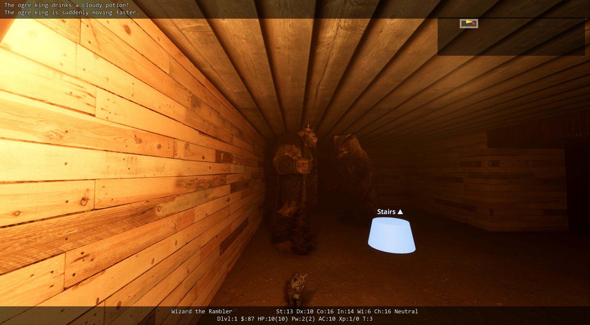
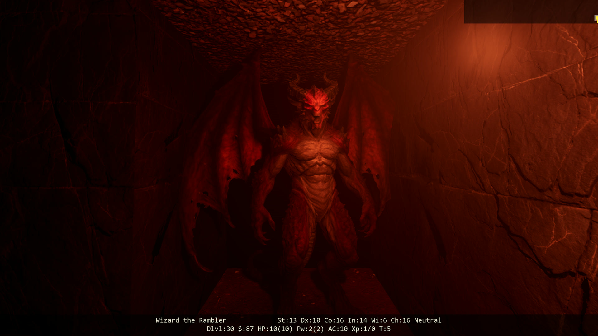
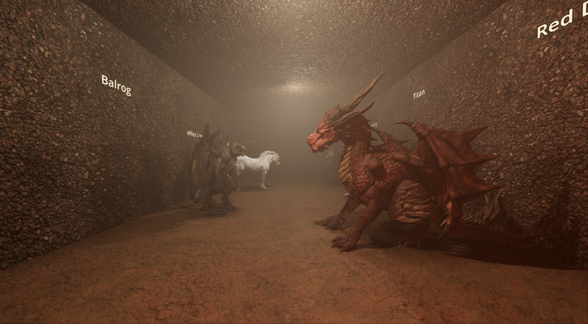
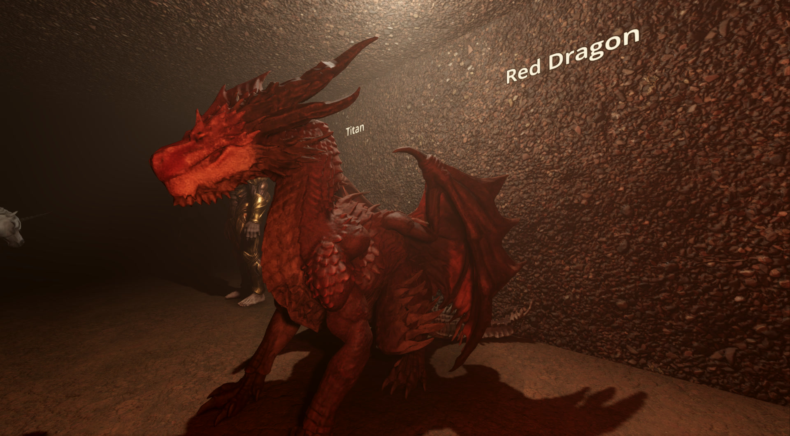

# We Are Hack – Rogue, Hack and NetHack in 3D and VR

**Step inside the classic roguelikes.** We Are Hack runs the *original, unmodified game code* of
**Rogue (1980)**, **Hack (1982)** and **NetHack 3.6.7 (1987)** and shows it as a 3D dungeon
you can walk through, on a monitor or in VR with controller support.

▶ **[Watch the trailer (MP4, 45 s)](media/trailer.mp4)**

| | |
|---|---|
|  |  |
|  |  |
|  |  |

## How it works

- The original game runs as its own program, exactly as it was written.
- A tiny probe reports the game's screen (and for NetHack a few extra values) to a
  [Godot 4](https://godotengine.org) front end.
- Godot turns every character into 3D: walls, floors, doors, items and over 370 monsters as
  3D models. Game logic, rules and randomness stay 100 % original.
- One start menu lets you pick the game. Desktop (mouse, keyboard, gamepad) and VR (OpenXR)
  are supported. English is the default language, German is available.

## Download

Get the Windows installer from the [Releases](../../releases) page.
It contains everything: Godot, Rogue, NetHack, all 3D monsters and the licence texts.

## Status and ideas

This is a hobby project, *vibe coded* with an AI assistant. The monster images and 3D models
are AI-generated as well (image models plus TRELLIS for image-to-3D).

It could become much more, for example animated monsters fighting in different phases,
a bit like the holographic chess in Star Wars. I don't have the time or resources for that,
so **forks and pull requests are very welcome**.

## Help wanted

Ideas I would love to see, and can't do alone:

- **Animated monsters** that move, attack and react, instead of standing still.
- **Fight scenes** played out between you and the monster, a bit like the holographic chess in Star Wars.
- **Hack (1982)**: porting the third game into the same 3D view.
- Better VR comfort, more textures, sounds, translations.

Fork the repository, build something, and open a pull request. Questions and ideas are welcome as issues.

## How to build

You need Windows, [Godot 4.7](https://godotengine.org/download) and, for the games themselves, MSYS2 (UCRT64) with gcc.

1. **NetHack:** get the NetHack 3.6.7 source, apply `patches/nethack/*.patch`, build with `nethack-bauen.sh` (MSYS2) into `nethack-spiel/`.
2. **Rogue:** get the Rogue 5.4.4 source ([Davidslv/rogue](https://github.com/Davidslv/rogue)), apply `patches/rogue/*.patch`, build with `rogue-bauen.bat`. Build the bridge `bruecke/rogue-bruecke.c` with gcc.
3. **3D view:** open `rogue-godot/project.godot` in Godot, or start a game with `rogue-3d-starten.bat` / `nethack-3d-starten.bat` (VR: `*-vr-starten.bat`).
4. **3D monsters:** the models are not in this repository. Copy the folders `nethack-monster/3d`, `hack-monster/3d` and `rogue-godot/modelle` from an installed copy of We Are Hack.
5. **Installer:** `paket-bauen.bat`, then NSIS with `setup.nsi`.

## Repository layout

| Folder | Content |
|---|---|
| `rogue-godot/` | Godot 4.7 project: 3D/VR view, start menu, monster gallery |
| `bruecke/` | Bridge between Rogue and Godot (C) |
| `patches/` | Our changes to Rogue and to NetHack 3.6.7 (the probe `wah_sonde.c`) |
| `nethack-monster/`, `hack-monster/` | Monster name mapping and the prompts used to create the images |
| `lizenzen/` | Licences of all third-party parts |
| `setup.nsi`, `paket-bauen.bat` | Building the Windows installer (NSIS) |

The 3D models and textures are not in this repository because of their size;
they are included in the installer.

Most file and variable names are in German, sorry about that.

## Licences

- Our own code: MIT, see [LICENSE](LICENSE).
- Rogue: BSD-style licence. NetHack: NetHack General Public License; this is a **modified
  version of NetHack**, our NetHack changes stay under the NetHack licence, and the installer
  contains the full NetHack source. NetHack is © the NetHack DevTeam; this is a fan project,
  not an official release.
- Godot: MIT. Textures, item models, sounds and music: CC0.
- Monster images and 3D models are AI-generated.

Everything in detail, with credits: [THIRD_PARTY_NOTICES.md](THIRD_PARTY_NOTICES.md).
